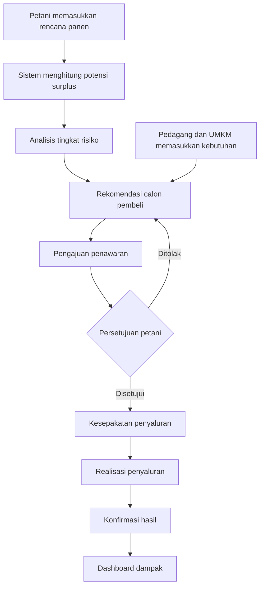

<div align="center">

# 🌾 PANENPULIH

### Smart Pre-Harvest Surplus Intelligence & Distribution Platform

**Antisipasi Surplus Panen, Hubungkan Kebutuhan, Selamatkan Hasil Pertanian.**

[](https://laravel.com/)
[](https://www.php.net/)
[](https://www.mysql.com/)
[]()

</div>

---

## 🌱 Tentang PANENPULIH

**PANENPULIH** merupakan platform berbasis web yang dirancang untuk membantu mengidentifikasi potensi kelebihan hasil panen sebelum masa panen tiba.

Sistem ini menghubungkan petani dengan pedagang, UMKM, dan pengolah pangan melalui pengolahan data perkiraan hasil panen, analisis potensi surplus, serta rekomendasi calon pembeli berdasarkan kebutuhan dan lokasi.

Berbeda dari sistem pemasaran hasil pertanian biasa, PANENPULIH berfokus pada **pencegahan surplus sejak sebelum panen**, sehingga hasil pertanian dapat direncanakan penyalurannya lebih awal.

### 🎯 Tujuan Pengembangan

- Mengurangi risiko hasil panen tidak terserap pasar.
- Membantu petani mengidentifikasi potensi surplus lebih awal.
- Mempermudah akses informasi kebutuhan hasil pertanian.
- Menghubungkan petani dengan calon pembeli yang sesuai.
- Memantau jumlah hasil panen yang berhasil disalurkan.

---

## ✨ Fitur Utama

| Fitur | Deskripsi |
|---|---|
| 📊 Harvest Planning | Pencatatan perkiraan hasil panen petani. |
| 📈 Surplus Analysis | Menghitung potensi surplus berdasarkan estimasi panen dan alokasi yang sudah direncanakan. |
| ⚠️ Surplus Risk Assessment | Mengidentifikasi tingkat risiko surplus berdasarkan beberapa indikator. |
| 🤝 Smart Buyer Matching | Merekomendasikan calon pembeli berdasarkan komoditas, jumlah, lokasi, dan waktu kebutuhan. |
| 🛒 Buyer Demand | Memungkinkan pedagang dan UMKM memasukkan kebutuhan komoditas. |
| 📦 Distribution Tracking | Memantau proses penawaran hingga realisasi penyaluran. |
| 📍 Location Mapping | Menampilkan informasi lokasi petani dan calon pembeli. |
| 📉 Impact Dashboard | Menampilkan statistik surplus dan hasil pertanian yang berhasil disalurkan. |

---

## 👥 Role Pengguna

PANENPULIH memiliki tiga jenis pengguna utama dan satu administrator.

### 👨‍🌾 Petani
- Mengelola profil petani.
- Memasukkan rencana panen.
- Melihat hasil analisis surplus.
- Menerima rekomendasi calon pembeli.
- Mengelola penawaran hasil panen.
- Memantau riwayat penyaluran.

### 🏪 Pedagang dan UMKM
- Mengelola profil pembeli.
- Memasukkan kebutuhan komoditas.
- Melihat rekomendasi surplus panen.
- Mengajukan pembelian.
- Memantau status pengajuan.

### 🛠️ Administrator
- Mengelola data pengguna.
- Memverifikasi akun.
- Mengelola data komoditas.
- Memantau aktivitas sistem.
- Melihat laporan dan statistik penyaluran.

---

## ⚙️ Alur Kerja Sistem



---

## 🧠 Sistem Analisis Surplus

PANENPULIH menggunakan perhitungan untuk mengidentifikasi potensi kelebihan hasil panen.

**Rumus Potensi Surplus:**

\[
S = H - P - K
\]

Keterangan:

- `S` = Potensi surplus.
- `H` = Estimasi hasil panen.
- `P` = Jumlah yang sudah memiliki pembeli.
- `K` = Jumlah yang dialokasikan untuk kebutuhan lain.

Sistem juga dirancang menggunakan penilaian risiko berdasarkan persentase surplus, waktu panen, karakteristik komoditas, kapasitas penyimpanan, dan ketersediaan pembeli.

> Hasil analisis merupakan rekomendasi berdasarkan data yang dimasukkan pengguna, bukan jaminan bahwa seluruh surplus akan terserap.

---

## 🛠️ Teknologi yang Digunakan

| Teknologi | Kegunaan |
|---|---|
| PHP 8.3 | Bahasa pemrograman backend |
| Laravel 13 | Framework pengembangan web |
| MySQL | Database management |
| HTML5 | Struktur halaman web |
| CSS3 | Desain dan tampilan antarmuka |
| JavaScript | Interaksi halaman |
| Bootstrap | Framework UI responsif |
| Leaflet | Peta interaktif |
| OpenStreetMap | Sumber data peta |
| Chart.js | Visualisasi data dan statistik |

---

## 📂 Struktur Project

```text
panenpulih/
│
├── app/
│   ├── Http/
│   │   ├── Controllers/
│   │   │   ├── Admin/
│   │   │   ├── Petani/
│   │   │   └── Pembeli/
│   │   └── Middleware/
│   │
│   └── Models/
│
├── database/
│   ├── migrations/
│   └── seeders/
│
├── public/
│
├── resources/
│   ├── css/
│   ├── js/
│   └── views/
│       ├── layouts/
│       ├── auth/
│       ├── landing/
│       ├── petani/
│       ├── pembeli/
│       └── admin/
│
├── routes/
│   └── web.php
│
├── .env.example
├── artisan
├── composer.json
└── README.md
```

---

## 🚀 Instalasi dan Menjalankan Project

Pastikan perangkat sudah memiliki:

- PHP 8.3 atau versi yang sesuai dengan dependensi Laravel.
- Composer.
- MySQL.
- Laragon atau lingkungan server lokal lainnya.

### 1. Clone Repository

```bash
git clone https://github.com/USERNAME/panenpulih.git
```

### 2. Masuk ke Folder Project

```bash
cd panenpulih
```

### 3. Install Dependencies

```bash
composer install
```

### 4. Buat File Environment

```bash
copy .env.example .env
```

### 5. Generate Application Key

```bash
php artisan key:generate
```

### 6. Konfigurasi Database

Buat database MySQL bernama:

```text
db_panenpulih
```

Sesuaikan konfigurasi `.env`:

```env
DB_CONNECTION=mysql
DB_HOST=127.0.0.1
DB_PORT=3306
DB_DATABASE=db_panenpulih
DB_USERNAME=root
DB_PASSWORD=
```

### 7. Jalankan Migration

```bash
php artisan migrate
```

### 8. Jalankan Development Server

```bash
php artisan serve
```

Buka aplikasi melalui:

```text
http://127.0.0.1:8000
```

---

## 🌍 Sustainable Development Goals (SDGs)

PANENPULIH mendukung:

<div align="center">

| SDG 2 | SDG 12 |
|:---:|:---:|
|  |  |
| **Zero Hunger** | **Responsible Consumption and Production** |

</div>

Melalui pengelolaan surplus hasil pertanian, PANENPULIH diharapkan dapat mendukung pemanfaatan pangan secara lebih optimal serta mengurangi kehilangan hasil pertanian.

---

## 📌 Project Status

**Development — In Progress**

PANENPULIH saat ini berada dalam tahap pengembangan prototipe. Fitur dan teknologi akan terus disempurnakan berdasarkan kebutuhan pengguna dan hasil pengujian.

---

